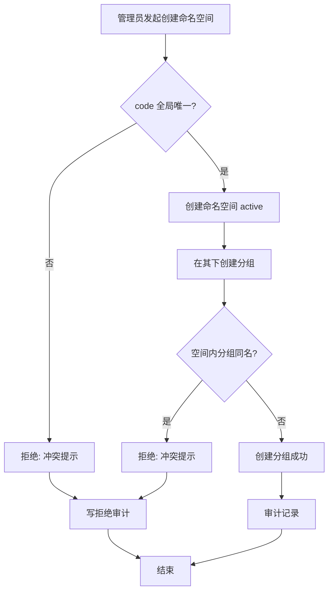
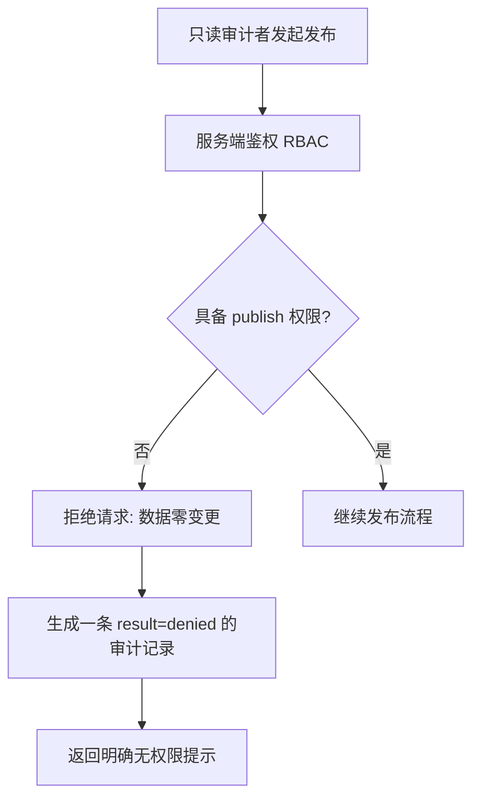
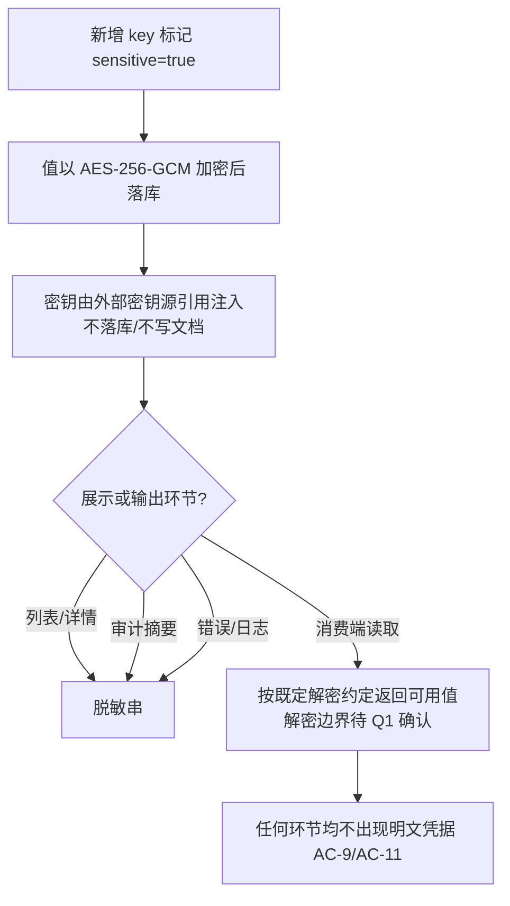
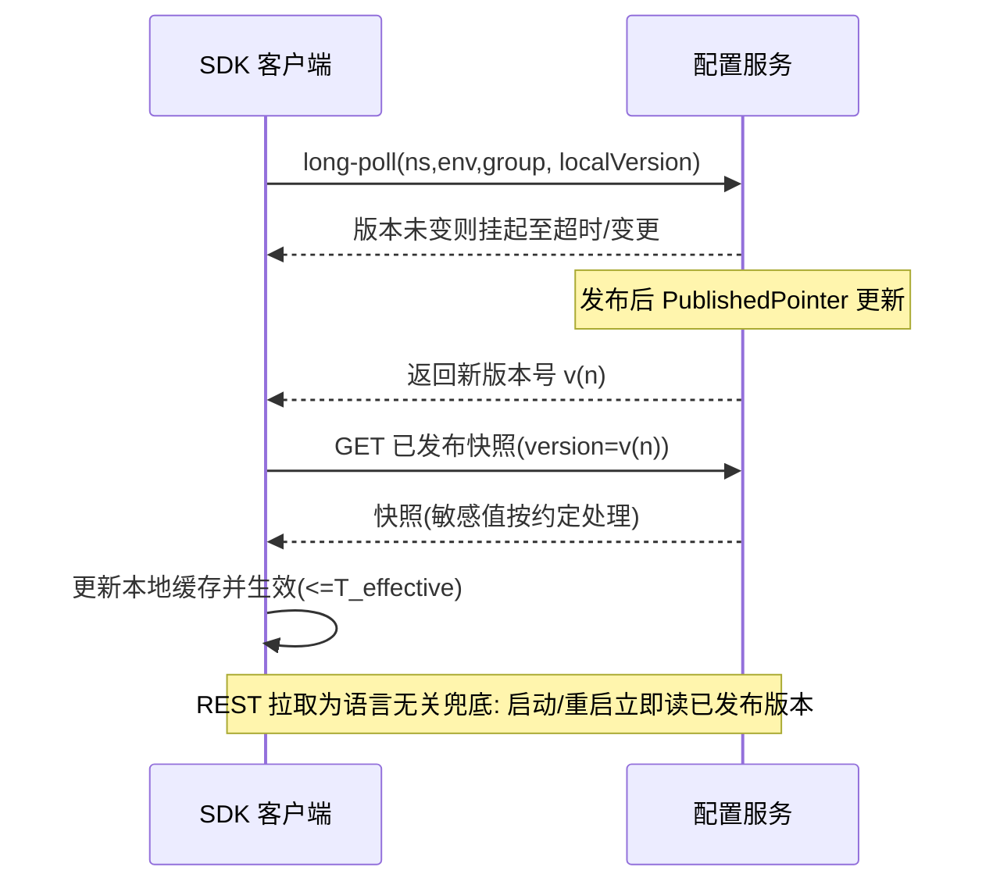

# 配置中心系统（基础版）产品方案设计

> 本文档为「方案设计」节点产物，基于上游需求定型产物 `requirement.md` 推导，用于把需求转化为可落地的产品方案：用户旅程、功能范围、交互流程、业务规则、风险与验收规范。
> **合规声明**：文中所有「验收标准 / 判定条件」均为**待后续 verifying 阶段执行的验证条件**，不代表已执行或已通过的事实结论；文中所有参数（时延阈值、密钥来源、配额等）未给出处一律标注为**假设 / 待确认**；**不包含任何真实凭据或密钥**，密钥与凭据仅以引用方式描述。
> 本节点为纯文档产物，不改动任何仓库代码。

---

## 0. 文档元信息

| 项目 | 内容 |
| --- | --- |
| 需求名称 | 配置中心系统（基础版） |
| 平台工作项 | issue-1795061266659410559 |
| 来源 | 本地 |
| 外部 ID | 无 |
| 定位 | 对标 Apollo / Nacos 的简化版，统一管理应用运行时配置项 |
| 上游产物 | `requirement.md`（需求定型，238 行，终态 pass） |
| 本文档状态 | 方案设计（待评审确认假设与待确认项） |
| 仓库上下文 | loopforge-demo（github:jkstg01/loopforge-demo），基线 main，工作分支 feature/requirement-1-20261119-0408（本次为纯文档产物，不改动仓库代码） |
| 交付物 | `design.md`（工作区根目录） |

---

## 1. 设计概述

### 1.1 设计目标

将需求定型的三项核心目标与 D1–D5 决策，转译为一个闭环可验证的产品方案：

1. **可管**：以「命名空间 → 环境 → 分组 → 键」的层级组织配置，提供统一增删改查入口。
2. **可发 / 可追 / 可退**：草稿与已发布分离；发布生成不可变版本快照；回滚以新版本实现，历史不删改。
3. **可隔离 / 可审计 / 可控权**：dev/test/prod 生命周期独立；写操作全量留痕；服务端强制 RBAC 鉴权。

### 1.2 设计原则

| 原则 | 含义 | 对应需求约束 |
| --- | --- | --- |
| 草稿与发布强隔离 | 编辑只触达草稿，消费端只读已发布快照 | 5.1、FR-4、AC-2/3 |
| 发布原子化 | 以「分组在某环境下的实例」为发布单位，快照全有或全无 | 5.1、FR-4、NFR 可靠性 |
| 版本不可变 | 版本只增不改不删；回滚 = 复制历史快照为新版本 | FR-5、AC-4 |
| 环境硬隔离 | 标识与查询强制携带 env，禁止跨环境读写 | FR-6、AC-5 |
| 安全默认 | 服务端鉴权、敏感值加密落库 + 全链路脱敏、审计 append-only | 5.2/5.3、FR-9/10 |
| 客户端最终一致 | 长轮询 + 版本号比对，REST 兜底，不承诺强一致 | 5.4、D2、AC-6 |
| MVP 最小闭环 | 不构成「管发追退离审权」闭环的功能不纳入 | D5、第 3 节 |

### 1.3 设计到需求的追溯

本文档新增的设计元素均锚定上游条目：模块见第 4 节（对应 FR-1~10），流程见第 5 节（对应 S1~S9），规则见第 6 节（对应 5.x 边界），风险见第 9 节，验收见第 10 节（对应 AC-1~11）。不新增超出 MVP 边界的功能承诺。

---

## 2. 产品信息架构与数据模型

### 2.1 层级模型

```
Namespace（命名空间，对应一个应用/系统）
 └── Env（环境：dev | test | prod，固定枚举，作为维度）
      └── Group（分组，定义隶属于 Namespace，跨环境共享"分组定义"）
           └── Key（配置项，(namespace, env, group, key) 唯一）
                ├── Draft（草稿工作副本，可编辑，消费端不可见）
                └── Versions v1..v(n)（已发布不可变快照，消费端唯一来源）
```

### 2.2 核心实体（逻辑层）

| 实体 | 关键字段（逻辑） | 说明 |
| --- | --- | --- |
| Namespace | id, code(全局唯一), name, description, status(active/archived), 审计字段 | FR-1 |
| Group | id, namespaceId, code(空间内唯一), name, description, status, 审计字段 | FR-2 |
| ConfigDraft | namespaceId, env, groupId, key, value(字符串), sensitive(布尔), description, updatedBy, updatedAt | 草稿副本，FR-3 |
| Version | id, namespaceId, env, groupId, versionNo=v(n), snapshot(key→{value, sensitive}), changeType(publish/rollback), sourceVersion, publishedBy, publishedAt | 不可变快照，FR-4/5 |
| PublishedPointer | (namespaceId, env, groupId) → currentVersionNo | 指向当前生效版本 |
| AuditLog | id, ts, actor, actorRole, action, targetType/targetId, scope(ns/env/group/key), before摘要, after摘要, result(success/denied), detail | append-only，FR-8 |
| RBAC | User, Role(Admin/Editor/Viewer/Consumer), Permission, Grant | FR-9 |

> 注：以上为逻辑模型，用于对齐产品语义；物理表结构、索引与存储选型属实现阶段，不在本方案承诺范围。敏感值在存储层以密文保存（见 BR-09）。

### 2.3 关键设计澄清：分组的「环境实例」与版本单位

上游需求中「分组隶属于命名空间」与「版本按分组原子发布」「环境隔离」三处表述存在需要一个精确化解释的点，本方案明确如下（**设计澄清，建议评审确认**）：

- 分组**定义**隶属于命名空间（跨环境共享同一分组定义，便于统一管理）；
- 但**草稿、版本序列、发布状态、当前生效版本**按 `(namespace, env, group)` 各自独立，即每个环境持有一个「分组环境实例」；
- 因此发布与版本的原子单位精确为 **`(namespace, env, group)`**。这与 AC-5「dev 发布不改变 prod 的值与版本」一致。

> 若评审确认「分组本身也按环境分别创建」，则本条退化为命名差异，不影响流程与规则；需同步确认 Q7 的分组/环境约束。

### 2.4 状态模型

**配置发布周期（按分组环境实例）**

```
[草稿编辑中] --发布--> [已发布 v(n)]
      ^                      |
      |------ 再次编辑 ------+   (草稿变更，已发布版本不变)
[已发布 v(n)] --发布--> [已发布 v(n+1)]
[已发布 v(n)] --回滚到历史 v(k)--> [已发布 v(n+1), changeType=rollback, sourceVersion=v(k)]
```

- 版本一经生成即不可修改、不可删除；历史版本永久可查。
- 回滚不「回到过去」，而是「把过去内容重新发布为最新版本」。

**命名空间**：`active → archived`（归档后不可再编辑/发布，历史保留）。
**分组**：`active → deleted`（删除前执行前置校验，见 BR-15）。

---

## 3. 用户旅程

### 3.1 角色与旅程总览

| 角色 | 旅程 ID | 核心目标 | 主要触点 |
| --- | --- | --- | --- |
| 系统管理员 Admin | J-A | 搭好组织与权限骨架 | 命名空间、分组、成员与角色 |
| 配置编辑者 Editor | J-E | 让正确配置在正确环境生效，且能追能退 | 草稿、发布、版本、回滚 |
| 只读审计者 Viewer | J-V | 看清现状与历史，验证合规 | 配置只读视图、审计日志 |
| 应用消费端 Consumer | J-C | 运行时拿到最新已发布配置且不中断 | REST 拉取、SDK 长轮询 |

### 3.2 J-A｜管理员：搭建组织与权限骨架

| 步骤 | 动作 | 系统响应 / 触点 | 完成标准 |
| --- | --- | --- | --- |
| A1 | 创建命名空间 `order-service` | 校验 code 唯一；成功则返回可查询对象（AC-1） | 命名空间可查 |
| A2 | 在其下创建分组 `datasource` | 校验空间内同名冲突；成功可查（AC-1） | 分组可见 |
| A3 | 分配成员角色（Editor / Viewer / Consumer 凭据） | 写入 Grant；服务端鉴权生效（BR-11/12） | 成员按角色受限 |
| A4 | （运维阶段）归档不再使用的命名空间 | 状态置 archived，停止编辑/发布，历史保留 | 归档生效且数据可查 |

> 对应场景 S1；失败分支（同名冲突、越权分配）见第 5.2、5.7 节。

### 3.3 J-E｜编辑者：配置从草稿到生效

| 步骤 | 动作 | 系统响应 / 触点 | 完成标准 |
| --- | --- | --- | --- |
| E1 | 在 dev / `datasource` 新增 key `db.url` | 写入草稿；值按字符串保存（D1） | 草稿可见，已发布无变化（AC-2） |
| E2 | 修改 `db.url`，标记/不标记敏感 | 仅草稿变更；敏感值加密落库、展示脱敏（AC-2/9） | 已发布版本读取仍为旧值（AC-2） |
| E3 | 发布前预览 diff，确认 | 生成 v(n)，快照该分组该环境全部 key（AC-3） | 版本可查，消费端读到新值 |
| E4 | 发现 v(n) 有误，回滚到 v(n-1) | 生成 v(n+1)，内容等于目标版本（AC-4） | 历史版本不变，最新生效为回滚结果 |
| E5 | 在 prod 独立重复配置与发布 | 与 dev 完全隔离（AC-5） | prod 值/版本不受 dev 影响 |

> 对应场景 S2–S5；编辑者无权限管理，尝试发布到未授权环境被拒（S8）。

### 3.4 J-V｜审计者：看清现状与历史

| 步骤 | 动作 | 系统响应 / 触点 | 完成标准 |
| --- | --- | --- | --- |
| V1 | 浏览配置（草稿/已发布，只读） | 只读视图，敏感值脱敏（AC-9） | 无编辑/发布入口 |
| V2 | 按 key 查询变更历史 | 返回操作人、时间、对象、动作、前后值摘要（AC-7） | 可定位任一变更 |
| V3 | 尝试发布（越权验证） | 被拒、数据未变、生成拒绝审计（AC-8） | 拒绝留痕 |

> 对应场景 S7、S8。

### 3.5 J-C｜消费端：运行时无中断取配置

| 步骤 | 动作 | 系统响应 / 触点 | 完成标准 |
| --- | --- | --- | --- |
| C1 | 集成 SDK（建议 Java）或 REST | 拉取当前已发布版本快照 | 启动即拿到已发布配置 |
| C2 | SDK 长轮询 + 版本号比对 | 版本变化则拉取新快照并本地更新 | 发布后 T_effective 内生效（AC-6） |
| C3 | 网络/服务端短时不可用 | SDK 本地缓存降级，恢复后追平 | 不因抖动导致配置丢失 |

> 对应 D2、D4、AC-6；T_effective 与 SDK 缓存能力为待确认项（Q2/Q3）。

---

## 4. 功能范围与模块拆解

### 4.1 功能架构

| 模块 | 职责 | 覆盖 FR | 对应场景 |
| --- | --- | --- | --- |
| M1 元数据管理 | 命名空间/环境/分组的创建、查询、归档/删除与前置校验 | FR-1, FR-2 | S1 |
| M2 配置编辑 | 按 (ns,env,group,key) 的 CRUD、草稿维护、敏感标记 | FR-3 | S2, S3, S9 |
| M3 发布与版本 | 按分组环境实例原子发布、版本快照、历史、回滚 | FR-4, FR-5 | S4, S5 |
| M4 配置分发 | REST 拉取（按版本）、长轮询变更检测、SDK 封装与缓存 | FR-7 | S4 |
| M5 审计 | 写操作（含拒绝）全量记录、条件查询 | FR-8 | S7, S8 |
| M6 安全与权限 | RBAC 服务端鉴权、敏感值加密与脱敏 | FR-9, FR-10 | S8, S9 |
| M7 管理控制台 | 上述能力的可视化入口，草稿/已发布状态清晰标识 | NFR 易用性 | 全部 |

### 4.2 范围内 / 范围外

- **范围内**：M1–M7 中对应 D5「管发追退离审权」闭环的全部能力；值统一按纯字符串处理；REST 必备 + 1 个官方 SDK（建议 Java）。
- **范围外**：文件型配置、结构化 JSON/YAML 编辑与校验、灰度/标签分发、模板与继承、跨环境晋升、服务端主动推送与强一致、多集群/多地域、发布审批工作流、完整密钥自动轮换、多语言 SDK（详见 `requirement.md` 第 3.2 节）。

---

## 5. 交互流程

### 5.1 流程清单

| 流程 | 场景 | 关键校验点 |
| --- | --- | --- |
| F1 建空间建组 | S1 | 命名唯一、鉴权 |
| F2 草稿编辑与发布 | S2–S4 | 草稿/发布隔离、原子快照、版本号 |
| F3 回滚 | S5 | 目标版本存在、复制为新版本 |
| F4 环境隔离 | S6 | env 强制注入 |
| F5 审计追溯 | S7 | 查询条件、脱敏 |
| F6 越权拒绝 | S8 | 服务端鉴权、拒绝留痕 |
| F7 敏感配置生命周期 | S9 | 加密落库、全链路脱敏 |
| F8 配置生效 | S4/D2 | 版本号比对、T_effective |

### 5.2 F1 建空间建组（S1）



### 5.3 F2 草稿编辑与发布（S2–S4）

```mermaid
sequenceDiagram
    participant U as 编辑者
    participant C as 控制台/API
    participant D as 草稿
    participant V as 版本/发布服务
    participant P as 已发布快照
    U->>C: 编辑 key=db.url
    C->>D: 写入草稿(值按字符串;敏感则加密)
    Note over D,P: 已发布快照保持不变 (AC-2)
    U->>C: 发布分组 dev/datasource
    C->>V: publish(ns,env,group,operator)
    V->>V: 校验权限 + 快照该实例全部key + 乐观锁校验(BR-05/17)
    V->>P: 原子写入 v(n) 并移动 PublishedPointer
    V->>V: 写审计(操作人/时间/对象/动作/前后摘要)
    C-->>U: 发布成功 v(n)
    Note over P: 消费端可读新值; 草稿不再影响线上 (AC-3)
```

**失败分支**：权限不足 → F6；并发发布冲突 → 拒绝并提示重试（BR-17）；快照写入失败 → 整体回滚、不产生半版本（BR-05）。

### 5.4 F3 回滚（S5）

```mermaid
flowchart TD
    A[编辑者选择回滚到历史 v(k)] --> B{有回滚权限?}
    B -- 否 --> X[拒绝+审计] --> Z
    B -- 是 --> C{v(k) 存在且不可变?}
    C -- 否 --> Y[拒绝: 目标不存在] --> Z
    C -- 是 --> D[复制 v(k) 快照全部内容]
    D --> E[作为新版本 v(n+1) 发布<br/>changeType=rollback, sourceVersion=v(k)]
    E --> F[移动 PublishedPointer] --> G[写审计] --> H[完成: v1..v(n) 不变, 内容与 v(k) 相等 AC-4]
```

### 5.5 F4 环境隔离（S6）

- 所有配置读写与发布请求**强制携带 env**，并在服务端把它作为过滤/校验条件（BR-08）。
- dev 的草稿修改、发布、版本递增只在 `(ns, dev, group)` 命名空间内发生；prod 的同名 key 值、版本序列、PublishedPointer 均不变化（AC-5）。
- 跨环境显式指定（如从 dev 读 prod）需独立权限校验，MVP 不提供自动同步/晋升。

### 5.6 F5 审计追溯（S7）

- 查询条件：时间范围、操作人、动作类型、对象范围（ns/env/group/key）、结果（success/denied）。
- 返回字段：操作人、角色、时间、对象、动作、前后值摘要、结果。
- **敏感值在摘要中一律脱敏**（BR-09），审计记录 append-only 不可篡改/删除（BR-13）。

### 5.7 F6 越权拒绝（S8）



> 关键点：鉴权在服务端执行，前端隐藏按钮不作为安全边界（FR-9、AC-8）。

### 5.8 F7 敏感配置生命周期（S9）



### 5.9 F8 配置生效：长轮询 + REST 兜底（D2 / AC-6）



- 不承诺服务端主动推送与瞬时强一致（最终一致，5.4 节）。
- `T_effective` 默认建议 ≤ 30s，为待确认参数（Q2）；轮询间隔应可配置以便对齐 SLA。

---

## 6. 业务规则

| 编号 | 规则 | 来源 |
| --- | --- | --- |
| BR-01 | 命名空间 code 全局唯一；分组 code 在所属命名空间内唯一；同名创建被拒并返回明确冲突提示 | FR-1/2, AC-1 |
| BR-02 | env 固定为 dev/test/prod，MVP 不支持自定义环境 | 假设1 |
| BR-03 | 配置项以 (namespace_id, env, group_id, key) 唯一标识，重复 key 创建被拒 | 5.1, FR-3 |
| BR-04 | 编辑只改草稿；消费端只读已发布版本；未发布草稿对消费端不可见 | 5.1/5.2, AC-2/3 |
| BR-05 | 发布以 (ns, env, group) 为原子单位，一次性快照该实例全部 key，全有或全无 | FR-4, NFR 可靠性 |
| BR-06 | 版本号 v(n) 单调递增；版本创建后不可修改、不可删除 | FR-5 |
| BR-07 | 回滚 = 取目标历史版本快照作为新版本发布，记录 sourceVersion；历史版本保留 | FR-5, AC-4 |
| BR-08 | 任一环境的编辑/发布/版本序列与其他环境独立，互不影响 | FR-6, AC-5 |
| BR-09 | 敏感值以 AES-256-GCM 加密落库；列表/详情/审计/错误/日志一律脱敏；密钥外部注入不落库 | FR-10, AC-9/11 |
| BR-10 | 值按纯字符串处理，JSON/YAML 原样存储与展示，不做结构化解析/格式校验 | D1, AC-10 |
| BR-11 | 所有读写在服务端强制鉴权，前端隐藏不作为安全边界；越权拒绝并留痕 | 5.2, FR-9, AC-8 |
| BR-12 | 按最小必要授权；消费端仅可读取已发布配置 | 5.2 |
| BR-13 | 所有写操作（含越权拒绝）生成审计记录；审计 append-only、不可篡改/删除 | 5.3, FR-8, AC-7/8 |
| BR-14 | 最终一致：发布后客户端在 T_effective 内收敛，不承诺瞬时强一致 | 5.4, AC-6 |
| BR-15 | 删除分组前校验其下配置状态（是否存在已发布版本等），按规则拒绝或按约定级联处理 | FR-2 |
| BR-16 | MVP 发布不引入审批工作流 | Q4, 范围外 |
| BR-17 | 同一分组环境实例并发发布采用乐观锁/版本校验，避免版本冲突与丢失更新 | 设计新增（应对风险 R-03） |

---

## 7. 权限设计（RBAC）

### 7.1 角色定义（继承需求 4.1）

- **Admin**：命名空间、环境成员、分组与角色分配，全部权限。
- **Editor**：配置草稿 CRUD、发布、回滚，查看配置与版本历史。
- **Viewer**：只读查看配置与审计，不可修改/发布。
- **Consumer**：运行时仅读取已发布配置。

### 7.2 权限矩阵

图例：✓ 允许 ｜ ✗ 拒绝 ｜ △ 设计建议开放（待评审）

| 动作 | Admin | Editor | Viewer | Consumer |
| --- | --- | --- | --- | --- |
| 创建 / 归档命名空间 | ✓ | ✗ | ✗ | ✗ |
| 创建 / 修改 / 删除分组 | ✓ | ✓ | ✗ | ✗ |
| 新增 / 修改 / 删除配置（草稿） | ✓ | ✓ | ✗ | ✗ |
| 发布配置 | ✓ | ✓ | ✗ | ✗ |
| 回滚配置 | ✓ | ✓ | ✗ | ✗ |
| 查看草稿 | ✓ | ✓ | △（只读） | ✗ |
| 查看已发布配置 | ✓ | ✓ | ✓ | ✓ |
| 查看版本历史 | ✓ | ✓ | ✓ | ✗ |
| 查看审计日志 | ✓ | △（只读） | ✓ | ✗ |
| 分配角色 / 管理成员 | ✓ | ✗ | ✗ | ✗ |
| 运行时读取已发布配置 | ✓* | ✓* | ✓* | ✓ |

> \* 管理角色在控制台可查看已发布配置；运行时消费应以独立 Consumer 凭据进行，便于审计与最小权限（BR-12）。

### 7.3 鉴权原则

1. 服务端对每个请求执行身份 + 权限判定，前端控制仅为体验优化（BR-11）。
2. 鉴权范围带 env 与 ns/group 维度，防止越环境/越空间访问（BR-08/12）。
3. 拒绝操作同样写审计（result=denied），支撑 S8 / AC-8。
4. 认证接入方式待确认（Q5）：方案层抽象认证接口，复用组织账号体系，不绑定具体实现。

---

## 8. 接口设计概览

> 以下 REST 路径为**方案级建议**，用于对齐交互；具体实现以开发阶段接口文档为准。所有读已发布配置的接口只返回已发布快照，不返回草稿（BR-04）。

### 8.1 REST 接口清单（建议）

| 能力 | 方法 / 路径（建议） | 关联 |
| --- | --- | --- |
| 命名空间 CRUD/归档 | `POST/GET /namespaces`、`POST /namespaces/{id}/archive` | FR-1 |
| 分组 CRUD | `POST/GET/PUT/DELETE /namespaces/{ns}/groups` | FR-2 |
| 配置草稿 CRUD | `POST/GET/PUT/DELETE /configs/draft` | FR-3 |
| 发布 | `POST /groups/{ns}/{env}/{group}/publish` | FR-4 |
| 版本历史 / 回滚 | `GET /groups/.../versions`、`POST /versions/{id}/rollback` | FR-5 |
| 读已发布（按版本/最新） | `GET /configs/published?ns=&env=&group=&version=` | FR-7 |
| 长轮询变更检测 | `GET /configs/watch?ns=&env=&group=&version=`（挂起至变更或超时） | FR-7, D2 |
| 审计查询 | `GET /audit-logs?...` | FR-8 |
| 成员/角色管理 | `POST /members/grant` 等 | FR-9 |

### 8.2 长轮询机制（D2）

- 客户端带本地版本号发起 watch；服务端在版本未变化时挂起请求，超时返回「无变更」；发布后新版本触发返回。
- 超时时间与 `T_effective` 对齐且可配置（Q2）；避免无限挂起导致连接资源耗尽（R-11）。
- 版本变化时客户端再拉取快照，减少响应体与比对成本。

### 8.3 SDK 职责（D4）

- 封装「首次拉取 → 本地缓存 → 长轮询 → 版本比对 → 缓存更新」；具备缓存降级能力（建议 MVP 具备，Q3 待确认）。
- 首版建议 Java；其他语言后续版本补充。
- 敏感值的解密边界（服务端解密后下发 vs 客户端解密）依赖 Q1 结论，本方案不预设。

---

## 9. 风险与应对

| 编号 | 风险 | 影响 | 应对 | 关联 |
| --- | --- | --- | --- | --- |
| R-01 | 敏感加密密钥来源/轮换/合规等级未定（Q1） | 阻断 D3 落地与 AC-9/11 合规验收 | 设计支持外部 KMS / 环境注入两种模式，密钥以引用注入、不落库不写文档；安全团队确认后固化 | D3, Q1 |
| R-02 | T_effective SLA 未定（Q2） | AC-6 判定标准模糊 | 默认建议 ≤30s，轮询间隔可配置；验收前与业务确认 | D2, AC-6 |
| R-03 | 同分组并发发布导致版本冲突/丢失更新 | 版本错乱、配置回退 | 乐观锁 + 版本校验（BR-17） | BR-05/17 |
| R-04 | 发布非原子导致快照不完整 | 线上配置部分生效 | 发布与快照同事务，失败整体回滚（BR-05） | NFR 可靠性 |
| R-05 | 草稿误发布 | 错误配置上线 | 控制台明确草稿/已发布标识、发布前 diff 预览、二次确认（NFR 易用性） | 5.1 |
| R-06 | 敏感值经日志/错误/diff 泄露 | 合规事故 | 统一脱敏输出层、审计仅存摘要、禁止明文日志（BR-09/13） | AC-9/11 |
| R-07 | 回滚内容与目标版本不一致 | 回滚失效、二次故障 | 基于不可变快照复制；AC-4 校验内容相等 | BR-07 |
| R-08 | 环境串扰 | prod 被 dev 变更污染 | 标识与查询强制注入 env；AC-5 校验（BR-08） | FR-6 |
| R-09 | 审计被篡改/删除 | 失去追溯能力 | append-only 存储、权限隔离、可选校验和（BR-13） | FR-8 |
| R-10 | 认证接入方式未定（Q5） | 影响 FR-9 落地与排期 | 抽象认证接口，确认后适配组织 SSO/账号体系 | Q5 |
| R-11 | 长轮询连接资源占用 | 规模上升后服务压力 | 超时 + 连接池/心跳；中小规模假设下可控（假设8） | D2 |
| R-12 | SDK 本地缓存陈旧/降级异常 | 客户端配置滞后 | 版本比对 + 降级策略，能力要求待 Q3 确认 | D4/Q3 |
| R-13 | 命名/配额规则缺失（Q7） | 校验规则不明确 | 预留校验扩展点，待 Q7 给出具体配额与字符规则 | FR-1/2 |

---

## 10. 验收规范

### 10.1 说明

> 本节全部为**待验证的判定条件**，供后续测试/验收阶段执行；当前未执行、未通过任何验证。每条沿用上游 AC 编号，补充「设计要点」与「验证方式」，不改动其通过含义。

### 10.2 需求 → 设计 → 验收 追溯矩阵

| FR / 决策 | 设计模块 | 业务规则 | 验收条件 |
| --- | --- | --- | --- |
| FR-1 命名空间与环境 | M1 | BR-01/02 | AC-1 |
| FR-2 分组管理 | M1 | BR-01/15 | AC-1 |
| FR-3 配置 CRUD | M2 | BR-03/04/10 | AC-2, AC-10 |
| FR-4 草稿与发布 | M3 | BR-04/05/06 | AC-2, AC-3 |
| FR-5 版本历史与回滚 | M3 | BR-06/07 | AC-4 |
| FR-6 环境隔离 | M2/M3 | BR-08 | AC-5 |
| FR-7 配置生效 | M4 | BR-14 | AC-6 |
| FR-8 审计日志 | M5 | BR-13 | AC-7, AC-8 |
| FR-9 RBAC | M6 | BR-11/12 | AC-8 |
| FR-10 敏感信息保护 | M6 | BR-09 | AC-9 |
| D1 不透明字符串 | M2 | BR-10 | AC-10 |
| 全局合规 | M6 | BR-09/13 | AC-11 |

### 10.3 验收条件（待验证）

| AC | 待验证条件（Given/When/Then） | 设计要点 | 验证方式（建议） |
| --- | --- | --- | --- |
| AC-1 | 给定已创建命名空间，当创建同名分组时，系统拒绝并返回明确冲突提示；创建成功的对象可被查询到 | BR-01 | 接口返回码/提示 + 查询断言 |
| AC-2 | 给定存在 key `db.url`，当编辑其值为 `X` 时，草稿显示 `X`，而已发布版本读取仍为发布前值 | BR-04 | 草稿读 vs 已发布读对比 |
| AC-3 | 当发布分组时，生成新版本号 v(n)，且该版本包含分组内全部 key 的快照；未发布前消费端读不到草稿值 | BR-05/06 | 版本快照内容比对 + 消费端读断言 |
| AC-4 | 给定存在 v1、v2，当回滚到 v1 时，生成 v3 且配置内容等于 v1；v1、v2 仍可查询且内容不变 | BR-07 | 内容等价断言 + 历史不可变检查 |
| AC-5 | 当在 dev 修改并发布 key K 时，prod 中同名 key K 的值与版本均未变化 | BR-08 | 跨环境值/版本快照对比 |
| AC-6 | 当发布配置后，在 T_effective 内 SDK 客户端读取到新值；REST 拉取接口在发布后立即返回已发布新值 | BR-14, D2 | 计时断言（阈值待 Q2 确认）+ REST 即时读 |
| AC-7 | 给定任一写操作，当查询审计日志时，可检索到该操作的执行人、时间、对象、动作及前后值摘要 | BR-13 | 审计记录字段完整性检查 |
| AC-8 | 给定只读审计者，当其尝试发布配置时，操作被拒绝、数据未变，且生成一条拒绝审计记录 | BR-11/12 | 越权调用 + 数据比对 + denied 记录 |
| AC-9 | 给定敏感 key，当查询其列表/详情/审计时，返回值均为脱敏串；直接检查存储层不含明文值 | BR-09 | 输出脱敏断言 + 存储层明文扫描 |
| AC-10 | 当写入含 JSON 文本的值时，平台原样保存与展示；不因结构非法而阻断写入 | BR-10 | 原样写入/读回比对 |
| AC-11 | 所有接口响应、日志与错误信息中，经检查均不包含任何明文凭据或密钥 | BR-09/13 | 全链路明文扫描（响应/日志/错误） |

### 10.4 验收准入 / 退出（建议，待确认）

- **准入**：Q1（密钥方案）、Q2（T_effective SLA）已确认，否则 AC-9/11 与 AC-6 无法判定；测试环境具备可检查存储层与日志的权限。
- **退出（建议）**：AC-1~AC-11 全部通过，且未引入范围外功能；所有「待确认项」有明确处置（确认或延期到后续版本）。
- 本节为准入/退出**建议**，不构成已验收结论。

---

## 11. 假设与待确认项（继承）

### 11.1 设计层新增/细化假设

| 编号 | 假设 | 说明 |
| --- | --- | --- |
| DA-1 | 发布与版本的原子单位精确为 (namespace, env, group)（2.3 节） | 由「环境隔离 + 分组原子发布」推导，建议评审确认 |
| DA-2 | REST 路径与接口清单为方案级建议 | 具体实现以开发阶段接口文档为准 |
| DA-3 | Viewer 可只读查看草稿、Editor 可只读查看审计（7.2 节 △） | 体验层设计建议，可由评审调整 |
| DA-4 | 首版 SDK 建议 Java，且具备本地缓存降级 | 继承假设4，优先级仍属 Q3 待确认 |

### 11.2 继承的待确认项（来自 `requirement.md` 第 10 节）

| 编号 | 待确认问题 | 对本方案的影响 |
| --- | --- | --- |
| Q1 | 敏感加密密钥来源/轮换/合规等级，是否消费端解密 | 阻断 D3 落地与 AC-9/11 判定（优先） |
| Q2 | T_effective 生效时延 SLA 取值 | 影响 D2 与 AC-6 判定（优先） |
| Q3 | 首版 SDK 语言优先级、是否必须本地缓存降级 | 影响 D4 与排期 |
| Q4 | 是否需要发布审批工作流 | 影响 FR-4 与 MVP 边界（本方案按不需要设计，BR-16） |
| Q5 | 认证方式如何接入组织账号体系 | 影响 FR-9 落地（7.3 节抽象认证接口） |
| Q6 | 是否为 JSON/YAML 增加最小合法性校验 | 影响 D1（本方案按不校验设计，BR-10） |
| Q7 | 命名空间/分组/环境的数量与命名约束 | 影响 FR-1/2 校验规则（R-13） |

> 上述待确认项在确认前，相关条目按「假设」处理，不得视为已定事实；Q1、Q2 建议优先确认，否则对应验收条件无法判定。

---

## 12. 术语（继承 + 新增）

| 术语 | 含义 |
| --- | --- |
| 命名空间 / 分组 / 环境 | 见 `requirement.md` 第 11 节 |
| 草稿 / 已发布版本 / 回滚 / 敏感值 / 最终一致 | 见 `requirement.md` 第 11 节 |
| 分组环境实例 | 本方案新增：某环境下分组的草稿、版本序列与发布状态集合，发布/版本的精确原子单位（2.3 节） |
| PublishedPointer | 指向某分组环境实例当前生效版本的引用 |
| T_effective | 发布到客户端生效的时延上限（待确认，建议 ≤30s） |

---

> **节点结论**：本方案已将需求定型产物完整转译为用户旅程、功能范围、交互流程、业务规则、风险登记与验收规范，并明确保留假设与待确认项。文中未包含任何真实凭据或密钥；所有验收条件均为待验证判定条件，未伪造任何验证或验收结果。产物写在根目录 `design.md`，未改动仓库代码。
